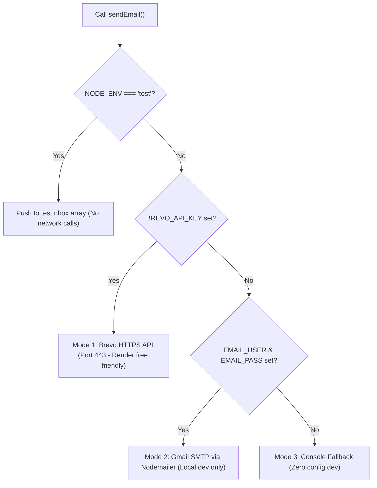

# Email Delivery Setup Guide for Found.

Found. implements a 3-mode email dispatcher in `backend/utils/sendEmail.js` designed specifically to operate within free hosting limits and developer environments.

---

## Why Render Free Tier Needs Brevo (HTTPS REST API)

On free hosting providers like **Render** and **Railway**, outbound connections on SMTP ports (`25`, `465`, `587`) are blocked by default to prevent spam bot abuse. Consequently, standard SMTP services (like Nodemailer pointing to Gmail or standard SMTP relays) fail on cloud deployments with `ETIMEDOUT` or `ECONNREFUSED`.

To solve this, Found. provides native support for the **Brevo (formerly Sendinblue) HTTPS REST API**, which sends emails via outbound HTTPS (`POST https://api.brevo.com/v3/smtp/email` on port 443). Outbound port 443 is universally permitted on all free tiers.

---

## The 3 Delivery Modes



---

## Mode 1: Brevo HTTPS API (Recommended for Render Free Tier)

Brevo provides a generous free tier of **300 transactional emails per day**, with zero credit card required.

### Step-by-Step Setup:
1. **Sign up**: Register for a free account at [brevo.com](https://www.brevo.com/).
2. **Verify Sender Email**:
   - Go to **Senders, Domains & Dedicated IPs** in the Brevo dashboard.
   - Click **Add a Sender**.
   - Enter your campus or personal email address (e.g. `yourname@gmail.com` or `found@yourcampus.edu`).
   - Click the verification link sent to your inbox.
3. **Generate API Key**:
   - Navigate to **SMTP & API** settings in the top right profile dropdown.
   - Click **Generate a new API key**.
   - Name it `found-render-production` and copy the generated key (`xkeysib-...`).
4. **Configure Environment Variables**:
   In your `backend/.env` file or Render dashboard:
   ```env
   BREVO_API_KEY=xkeysib-your-copied-brevo-api-key
   EMAIL_FROM=your-verified-sender@gmail.com
   ```

---

## Mode 2: Gmail SMTP via App Password (Local Development Only)

If you prefer testing email delivery directly to your personal inbox during local development:

### Requirements:
1. Go to your [Google Account Security Settings](https://myaccount.google.com/security).
2. Ensure **2-Step Verification** is turned ON.
3. Search for **App Passwords** in the search bar.
4. Create a new App Password named `Found Local Dev`.
5. Google will provide a 16-character code (e.g. `abcd efgh ijkl mnop`).
6. Add to `backend/.env`:
   ```env
   EMAIL_USER=your-email@gmail.com
   EMAIL_PASS=abcdefghijklmnop
   EMAIL_FROM="Found. Campus Board" <your-email@gmail.com>
   ```

> ⚠️ **Warning**: Do not use Mode 2 on Render free tier. Render blocks port 465/587, causing timeouts. Use Mode 1 on Render.

---

## Mode 3: Console Fallback (Zero-Config Development)

If neither `BREVO_API_KEY` nor `EMAIL_USER`/`EMAIL_PASS` are defined, Found. automatically prints all outgoing emails (including 6-digit verification codes and password reset links) directly to your server console:

```text
================== [EMAIL FALLBACK] ==================
To:      arjun@example.com
Subject: Your Found. Verification Code
Body:
Hello Arjun Kumar,

Your 6-digit verification code for Found. is: 749201

This code will expire in 10 minutes.

- The Found. Team
======================================================
```

You can copy the 6-digit code directly from your terminal and test the full registration flow without creating any third-party accounts.

---

## Testing Environment (`NODE_ENV=test`)

During automated test executions (`npm test`), emails are intercepted in memory and appended to the exported `testInbox` array in `backend/utils/sendEmail.js`. No outbound network calls are made, ensuring tests run offline, fast, and reliably without hitting API rate limits.
